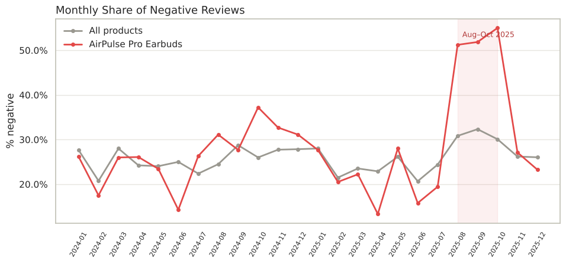

# Customer Review Sentiment Analysis
**Voice-of-Customer intelligence for a consumer electronics brand — end-to-end data science case study**

🔗 **Live demo:** `https://brmsyh-sentiment-analysis.streamlit.app`



## Business Problem
A U.S.-based direct-to-consumer **consumer electronics** company (audio, wearables, smart-home devices and charging accessories) sells through its own webstore, Amazon, Walmart Marketplace and Best Buy Marketplace. Its CX team was tagging reviews by hand and could only read a weekly sample, so product issues were found late.

**Goal:** build a model that classifies reviews as **positive / neutral / negative** from the text alone (no star rating), and find what drives negative sentiment.

> ℹ️ **About the data:** this case study uses a purpose-built dataset (`generate_dummy_data.py`) that replicates the structure, noise and business patterns of a real e-commerce review export.

## Results
| Metric (hold-out test set, 1,177 reviews) | Target | Result |
|---|---|---|
| Macro F1 | ≥ 0.80 | **0.859** |
| Recall: negative class | ≥ 0.85 | **0.885** |

**Final model:** tuned Logistic Regression on TF-IDF (unigrams + bigrams) plus engineered text features, delivered as a single scikit-learn pipeline that accepts **raw** text.

## Key Business Insights
1. **Earbud connectivity incident:** the negative share for the best-selling earbuds jumped from about 20% to **51–55% in Aug–Oct 2025**, and 67% of those complaints mention connectivity.
2. **Smart Home app:** the camera and smart plug have the highest negative share (~33%), and **62%** of their negative reviews mention the app.
3. **Service before hardware:** support (27%) and shipping (25%) are the aspects mentioned most often in negative reviews.
4. **Power bank pricing:** it has the highest neutral share (26%), which suggests a value-perception issue.

## Project Structure
```
review-sentiment-analysis/
├── app.py                           # Streamlit demo app (single + batch prediction, dashboard)
├── .streamlit/config.toml           # app theme
├── data/customer_reviews.csv        # raw review dataset (6,130 rows)
├── images/                          # charts for the README / portfolio
├── models/best_model_sentiment.pkl  # full pipeline (preprocessing + model)
├── notebook.ipynb                   # main analysis: Introduction → Conclusion
├── model_inference.ipynb            # inference on new raw reviews (separate)
├── text_utils.py                    # custom cleaning & transformers used by the pipeline
├── generate_dummy_data.py           # script that creates the case-study dataset
├── requirements.txt                 # app + analysis dependencies
└── requirements-dev.txt             # ipykernel for running notebooks in VS Code
```

## Streamlit App
| Tab | What it does |
|---|---|
| 🔍 Single review | Type any review or ticket → sentiment, confidence and class probabilities |
| 📂 Batch prediction | Upload a CSV → scored file with a priority queue for the CX team (download as CSV) |
| 📊 Insights dashboard | Negative-share trend, sentiment by product and complaint drivers, with filters |
| ℹ️ About the model | Approach, leakage control and test-set results |

## Notebook Outline
I. Introduction · II. Business Objectives · III. SMART Method · IV. Import Libraries · V. Load Dataset · VI. Data Cleaning · VII. EDA (8 analyses) · VIII. Feature Engineering (text features, cardinality check, data split, outlier detection & handling, feature selection, scaling & encoding) · IX. Model Definition · X. Model Training · XI. Model Evaluation (incl. tuning, interpretation, error analysis) · XII. Model Saving · XIII. Model Inference (separate notebook) · XIV. Conclusion

## How to Run (VS Code)
```bash
python -m venv .venv
# Windows: .venv\Scripts\activate   |   macOS/Linux: source .venv/bin/activate
pip install -r requirements.txt -r requirements-dev.txt
python generate_dummy_data.py        # optional: the CSV is already included
streamlit run app.py                 # opens the app at http://localhost:8501
```
Open `notebook.ipynb` in VS Code, select the `.venv` kernel and click **Run All**. Then open `model_inference.ipynb` to score new reviews.

## Deploy (Streamlit Community Cloud, free)
1. Push this folder to a **public GitHub repository**.
2. Go to [share.streamlit.io](https://share.streamlit.io), sign in with GitHub and click **Create app**.
3. Select the repository, branch `main` and main file `app.py`. In **Advanced settings**, choose Python 3.12.
4. Click **Deploy**. Copy the app URL into this README and into your Upwork/LinkedIn portfolio.

> The saved `.pkl` was created with scikit-learn 1.9.1. If you use a different version, run `notebook.ipynb` again to regenerate the model.

## Tech Stack
Python · pandas · scikit-learn · Streamlit (TF-IDF, Pipeline, ColumnTransformer, GridSearchCV) · SciPy (Chi-square, Kruskal-Wallis) · matplotlib · seaborn
